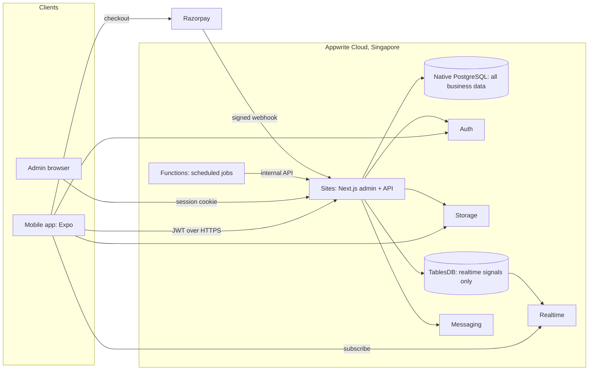

# System Overview

**Source of truth for how the system is built.** Today only the foundation exists; see [Project status](../delivery/PROJECT_STATUS.md). Everything else here is the design.

## Shape

One modular monolith: a single Next.js application serves the admin dashboard and the API. The mobile app talks only to that API, plus Appwrite for sign-in, file upload and realtime signals. Mobile never connects to PostgreSQL.

## Where data lives

| Data                                                                                                  | Store                                        | Why                                                   |
| ----------------------------------------------------------------------------------------------------- | -------------------------------------------- | ----------------------------------------------------- |
| Profiles, requirements, leads, connections, messages, portfolios, subscriptions, payments, audit logs | PostgreSQL                                   | Transactions, joins, one backup, one deletion path    |
| Credentials, sessions, phone, email                                                                   | Appwrite Auth                                | Do not duplicate identity                             |
| Images, videos, documents                                                                             | Appwrite Storage; metadata in `media_assets` | Purpose-built                                         |
| "Something changed for this user" signal                                                              | TablesDB, one row per user                   | Only way to use Appwrite Realtime; carries no content |
| Push tokens                                                                                           | Appwrite Messaging targets                   | Avoids a second token store                           |

## Key flows

- **Sign-in.** Mobile signs in with Appwrite, creates a 15-minute JWT and sends it as a bearer token. The API verifies it with Appwrite, then loads the user and roles from PostgreSQL. See [Auth architecture](AUTH_ARCHITECTURE.md).
- **Requirement to connection.** Customer posts; matching providers see a lead; provider shows interest; customer accepts; a connection and conversation are created in one transaction. See [Lead generation](../product/LEAD_GENERATION.md).
- **Chat.** The API writes the message to PostgreSQL, then updates the recipient's signal row. The app sees the signal and refetches. See [Realtime architecture](REALTIME_ARCHITECTURE.md).
- **Subscription.** The API creates a checkout; the gateway confirms by signed webhook; a transaction activates the subscription. See [Payment flow](diagrams/PAYMENT_FLOW.mmd).
- **Side effects.** Emails, pushes and signals that must not be lost are written to an outbox table in the same transaction, and a cron Function drains it.

## Layers

| Layer          | Location                                  | Rule                                                       |
| -------------- | ----------------------------------------- | ---------------------------------------------------------- |
| Screens        | `apps/web/src/app`, `apps/mobile/src/app` | Render only                                                |
| Route handlers | `apps/web/src/app/api`                    | Authenticate, validate, call a service, shape the response |
| Services       | `packages/domain` (from M2)               | Business rules and permissions; framework-free             |
| Data access    | `packages/database`                       | All SQL                                                    |
| Contracts      | `packages/contracts`                      | Zod schemas shared by client and server                    |

## Constraints

- Node.js runtime for all routes that touch the database. The Next.js Edge runtime cannot open TCP sockets.
- The pooler runs in transaction mode: no `LISTEN/NOTIFY`, advisory locks, temporary tables or `SET LOCAL` on the pooled URL.
- No microservices. Split a module out only with an ADR showing a real need.
- Mobile releases cannot be recalled, so the API is versioned and stays backward compatible.

## Unverified

The design depends on spikes S-01 to S-08 in [Assumptions](../project/ASSUMPTIONS.md). No code has connected to Appwrite yet.
