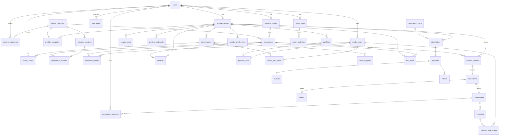

# Entity Relationship Diagram

**Implemented:** `users`, `customer_profiles`, `provider_profiles`, `admin_users`, `service_categories`. **All others Planned.** Field details: [Schema reference](SCHEMA_REFERENCE.md).

Standalone tables: `payment_events`, `banners`, `outbox_events`, `rate_limits`.

## Changes from the original entity list

| Change                                                                                                                                        | Why                                                                                                                                                 |
| --------------------------------------------------------------------------------------------------------------------------------------------- | --------------------------------------------------------------------------------------------------------------------------------------------------- |
| `requirement_questions` becomes `category_questions`                                                                                          | Questions belong to a category and are versioned; answers belong to a requirement                                                                   |
| `device_tokens` removed                                                                                                                       | Appwrite Messaging stores push targets ([ADR-012](../architecture/ARCHITECTURE_DECISIONS.md#adr-012-native-push-tokens-through-appwrite-messaging)) |
| `ratings` merged into `reviews`                                                                                                               | One rating per review; two tables would duplicate it                                                                                                |
| `provider_analytics` replaced by `provider_profile_views`                                                                                     | Store events and derive numbers                                                                                                                     |
| `reports` becomes `content_reports`                                                                                                           | Clearer name; business reports are queries                                                                                                          |
| `user_profiles` named `users`                                                                                                                 | Avoids two identity concepts                                                                                                                        |
| Added `payment_events`, `outbox_events`, `rate_limits`, `saved_content`, `banners`, `content_post_media`, `message_attachments`, `shortlists` | Needed by workflows                                                                                                                                 |
