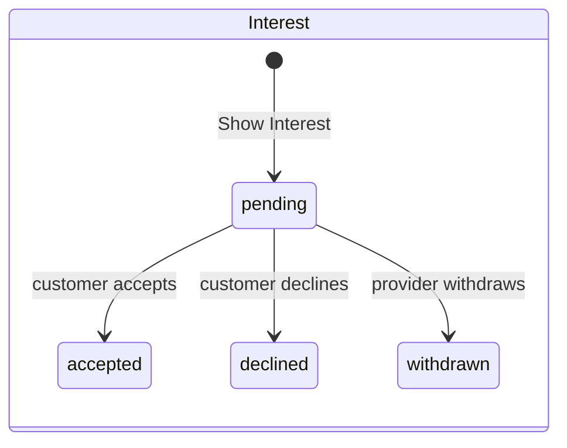

# Lead Generation

**Status:** Planned for M5 and M6. Rules: [Business rules](BUSINESS_RULES.md). Diagram: [LEAD_FLOW](../architecture/diagrams/LEAD_FLOW.mmd). Everything about distribution is a working default pending D-08.

## Lifecycle

## Matching (first version)

A requirement appears to a provider when all are true:

1. Requirement status is `active`.
2. Requirement's category is in `provider_categories`.
3. Requirement's location falls in a `service_areas` row. First version matches by city and state. Distance-based matching (PostGIS is available) waits for a need.
4. Provider has lead access.
5. Provider is not the requirement's owner.

Sort newest first. Filter by location, budget and deadline (Confirmed). No scoring.

## Visibility by stage

| Field                                                   | Lead feed | After interest | After connection          |
| ------------------------------------------------------- | --------- | -------------- | ------------------------- |
| Category, answers, budget, timeline, description, media | Yes       | Yes            | Yes                       |
| City or locality                                        | Yes       | Yes            | Yes                       |
| Customer first name                                     | No        | No             | Yes                       |
| Exact address                                           | No        | No             | If the customer shares it |
| Phone, email                                            | No        | No             | If the customer shares it |

Provider data visible to the customer at each stage: profile, portfolio and ratings are always visible. Provider contact details appear only after connection.

## Questions for the client (D-08)

1. Maximum providers per requirement?
2. Monthly interest limit per provider or plan?
3. Are leads visible to all matching providers at once, or staged?
4. Can a customer start contact with a provider who has not shown interest?
5. How long does a requirement stay active? (Default 60 days)

## Abuse controls

- Rate-limit Show Interest per provider per hour.
- Rate-limit requirement posting per customer per day.
- Let customers report a provider.
- Flag repeated copy-paste notes in the admin view.

## Metrics

Requirements posted, percentage receiving at least one interest within 48 hours, time to first interest, acceptance rate, connections per requirement.
