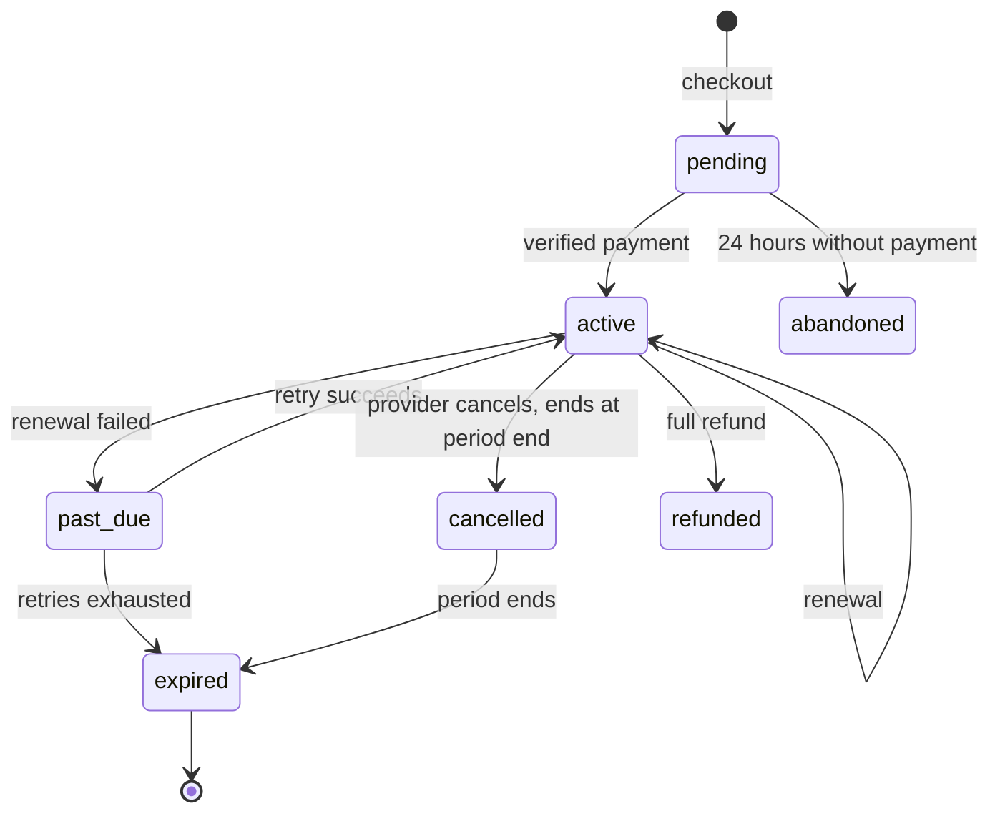

# Subscription Model

**Status:** Planned. **Blocked by D-04 (tiers) and D-05 (mechanism).** Nothing below defines a price.

## Confirmed

Providers pay a platform subscription to activate their account. Admins control plans, invoices and payment reports. No tier, price, period or benefit is defined anywhere.

## States

## Access rule

Lead access tests `current_period_end > now()` directly, and does not rely on a job having updated the status. Grace periods follow D-04.

## What lapses (Assumption, D-04)

| Item                        | After lapse  |
| --------------------------- | ------------ |
| New leads, Show Interest    | Stops        |
| Existing connections, chats | Continue     |
| Profile and portfolio       | Stay visible |
| New posts to discovery      | Stops        |

## The billing question

See [D-05](../project/OPEN_DECISIONS.md#d-05-in-detail). Razorpay inside the iOS and Android apps may breach store rules because the subscription unlocks digital functionality in the app.

The design keeps all options open:

| Column                                    | Purpose                                        |
| ----------------------------------------- | ---------------------------------------------- |
| `subscriptions.billing_provider`          | `razorpay`, `apple`, `google`                  |
| `subscriptions.provider_subscription_id`  | The billing system's ID                        |
| `subscription_plans.provider_product_ids` | Razorpay plan, App Store product, Play product |

All providers feed one service: `applyBillingEvent(event)`. Everything downstream depends only on subscription state.

**Action before M4:** get a written answer from App Review or legal counsel and record it in D-05. Do not submit an app with Razorpay checkout on the assumption that it will pass.

## Razorpay notes

Razorpay Subscriptions offers plans, automated charges, UPI AutoPay and e-mandates. Exact state names and webhook events must be taken from the [states](https://razorpay.com/docs/payments/subscriptions/states.md) and [webhooks](https://razorpay.com/docs/payments/subscriptions/subscribe-to-webhooks.md) pages during M4. They were not verified for this document. Their native React Native SDK and compatibility with Expo also need checking.
