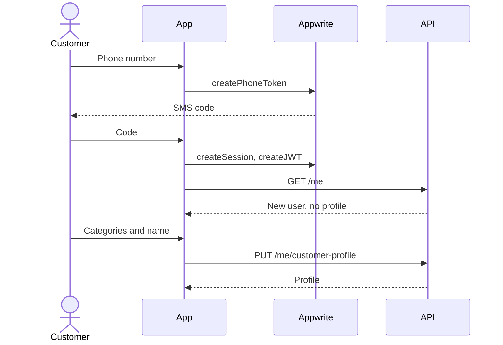

# User Flows

The 18 required workflows. All are Planned. Rules marked (D-xx) use a working default from [Open decisions](../project/OPEN_DECISIONS.md). Endpoints are in [API reference](../api/API_REFERENCE.md). Overall acceptance tracking is in [Acceptance criteria](../delivery/ACCEPTANCE_CRITERIA.md).

## 1. Customer registration

- **Actors:** Customer, Appwrite Auth, API.
- **Entry:** App installed, not signed in.
- **Happy path:** Enter phone; receive SMS; enter code; session created; `GET /me` creates the `users` row; choose categories; submit basic profile; reach Home.
- **Alternatives:** Email OTP; social login (D-11); skip optional fields; returning user goes directly to Home.
- **Failures:** Wrong code (retry with limit); SMS not delivered (resend after 30 seconds; email option); rate limited; network loss keeps the entered number.
- **Permissions:** Public until signed in; a user can only create their own profile.
- **Data:** `users`, `customer_profiles`, customer preferred categories.
- **Notifications:** None.

**Acceptance:** A new number reaches Home with a profile. Repeating `GET /me` never creates a second user. A wrong code never creates a session. The sixth attempt within the limit window is refused.

## 2. Provider registration and verification

- **Actors:** Provider, Admin.
- **Entry:** Signed in, no provider profile.
- **Happy path:** Business info; categories; service areas; experience; upload certifications; submit; status `pending_review`; admin approves.
- **Alternatives:** Save and resume at any step; edit after rejection and resubmit.
- **Failures:** Upload fails (retry per file); invalid area; profile incomplete on submit (fields listed).
- **Permissions:** Owner edits; only admins change approval status.
- **Data:** `provider_profiles`, `provider_categories`, `service_areas`, `media_assets`.
- **Notifications:** Admin queue count; provider on decision.

**Acceptance:** A provider cannot set their own status through any API field. A draft survives restarting the app. A provider below `approved` sees no leads.

## 3. Subscription checkout and activation

- **Actors:** Provider, Payment gateway, API. Mechanism depends on D-05. Order depends on D-10.
- **Entry:** Provider approved, no active subscription.
- **Happy path:** Choose plan; `POST /subscriptions/checkout`; complete payment; signed webhook activates subscription and creates payment and invoice; app shows active.
- **Alternatives:** Webhook arrives before the app returns; app shows "confirming" and polls; renewal charges arrive the same way.
- **Failures:** Payment fails (retry); webhook delayed (daily reconciliation); invalid signature (rejected, logged); duplicate events (ignored).
- **Permissions:** Owner only. Activation only from a verified event.
- **Data:** `subscriptions`, `payments`, `payment_events`, `invoices`.
- **Notifications:** Activation push and email; failure push.

Sequence: [PAYMENT_FLOW](../architecture/diagrams/PAYMENT_FLOW.mmd).

**Acceptance:** Calling the client callback without paying activates nothing. Sending the same webhook 5 times creates one payment. An altered body returns 400. Two rapid checkouts create one pending subscription.

## 4. Customer requirement creation

- **Actors:** Customer.
- **Entry:** Customer profile exists.
- **Happy path:** Choose category; answer questions for that category's current version; location, budget, timeline, description; add photos; review; submit; status `active`.
- **Alternatives:** Save draft; come back later; edit or close afterwards.
- **Failures:** Invalid answer for question type; category disabled during entry; upload fails; network loss keeps the draft on the device.
- **Permissions:** Owner only. Exact address is hidden from providers before connection (D-08).
- **Data:** `requirements`, `requirement_answers`, `requirement_media`, outbox.
- **Notifications:** Matching available providers (rate-limited digest).

**Acceptance:** Missing required answers return 422 with field errors. Answers remain correct after the category's questions change. Double-tap submit creates one requirement.

## 5. Dynamic service form configuration

- **Actors:** Admin.
- **Entry:** `operations` or `super_admin`.
- **Happy path:** Open category; add or reorder questions (text, number, single, multi, date, budget range); preview; publish a new version.
- **Alternatives:** Disable a question in a new version.
- **Failures:** Publishing with no questions refused; invalid option list refused.
- **Permissions:** Admin only; audit logged.
- **Data:** `category_questions` with `version`. Old versions stay for existing answers.
- **Notifications:** None.

**Acceptance:** A published change appears for new requirements only. A mobile app with an older cache receives a clear validation error instead of a silent loss. Past requirements still display their original questions.

## 6. Provider lead discovery

- **Actors:** Provider.
- **Entry:** Lead access (approved, active subscription, account active), available for leads.
- **Happy path:** Open feed; see active requirements matching categories and service areas, newest first; filter by location, budget and deadline; open details.
- **Alternatives:** Empty state; lead already acted on shows its state.
- **Failures:** Subscription lapsed: 403 with a renewal prompt.
- **Permissions:** Server-enforced lead access. Customer identity and contact details hidden.
- **Data:** Read only. Optionally records `lead_views`.
- **Notifications:** None.

**Acceptance:** A provider without lead access gets 403 even by calling the API directly. Closed requirements never appear. Response has no customer phone, email or exact address.

## 7. Show Interest

- **Actors:** Provider, Customer.
- **Entry:** Viewing an active lead with lead access.
- **Happy path:** Tap Show Interest with optional note; status `pending`; customer notified.
- **Alternatives:** Withdraw while pending; cap per requirement if D-08 sets one.
- **Failures:** Already interested (returns existing record); requirement closed (409); access lost (403).
- **Permissions:** Lead access only. Provider cannot act on their own requirement.
- **Data:** `provider_interests`, outbox.
- **Notifications:** Customer push and in-app.

**Acceptance:** Concurrent duplicate requests create one row. A provider cannot show interest in their own requirement.

## 8. Mutual connection

- **Actors:** Customer, Provider.
- **Entry:** A pending interest.
- **Happy path:** Customer reviews and accepts; transaction marks interest accepted and creates a connection and conversation.
- **Alternatives:** Shortlist for later; decline; connect with several providers.
- **Failures:** Interest withdrawn or requirement closed (409); double accept returns the same connection.
- **Permissions:** Only the requirement's owner accepts.
- **Data:** `provider_interests`, `connections`, `conversations`, `conversation_members`, outbox.
- **Notifications:** Provider push.

**Acceptance:** Accept is atomic: a forced failure leaves no partial records. Another customer cannot accept. A declined provider gets no contact details.

## 9. Conversation creation

- **Actors:** System.
- **Entry:** Connection created. Conversations exist **only** through connections.
- **Happy path:** Created inside flow 8 with two members.
- **Failures:** Rolled back with the connection.
- **Permissions:** No public endpoint creates a conversation.
- **Data:** `conversations`, `conversation_members`.
- **Notifications:** None separately.

**Acceptance:** No API lets two unconnected users start a chat. One connection has exactly one conversation.

## 10. Chat messaging

- **Actors:** Connected customer and provider.
- **Entry:** Member of an open conversation.
- **Happy path:** Send text or attachment; saved; recipient signaled; recipient fetches.
- **Alternatives:** Offline: queued with a visible pending state; recipient offline gets a push. Call: a dialer link if shared (D-06).
- **Failures:** Send fails (retry with the same key); conversation closed or user suspended (403); signal lost (polling catches up).
- **Permissions:** Members only, checked on every read and write.
- **Data:** `messages`, `message_attachments`, `conversations.last_message_at`, outbox.
- **Notifications:** Push when not viewing. Push body omits sensitive content.

Sequence: [CHAT_FLOW](../architecture/diagrams/CHAT_FLOW.mmd).

**Acceptance:** A retry with the same key creates one message. A non-member gets 404. A Realtime outage delays by no more than the polling interval and loses nothing.

## 11. Media upload

- **Actors:** Customer, Provider.
- **Happy path:** Request upload, upload to Storage, complete; server verifies and registers.
- **Alternatives:** Resume chunked upload; compress images and video on the device first.
- **Failures:** Too big, wrong type, or real type differs from declared (rejected and deleted); abandoned (cleaned up after 24 hours).
- **Permissions:** Owner registers. Private files are served through the API only.
- **Data:** `media_assets`.
- **Notifications:** None.

**Acceptance:** A `.exe` renamed to `.jpg` is rejected. Another user's private file returns 403 or 404, including by direct Storage URL.

## 12. Content publishing and moderation

- **Actors:** Provider, Customer, Moderator.
- **Happy path:** Provider creates a post with media and tags; published (D-15); appears in discovery; customer can report; moderator removes or keeps.
- **Alternatives:** Pre-moderation queue if D-15 chooses it.
- **Failures:** Upload incomplete; subscription lapsed (D-04 decides if old posts remain).
- **Permissions:** Owner edits. Moderators change status with a reason.
- **Data:** `content_posts`, `portfolio_items`, `media_assets`, `content_reports`, `admin_audit_logs`.
- **Notifications:** Provider on removal.

**Acceptance:** Removed content disappears from all feeds at once. Moderation is audit logged. Reporting twice does not create duplicates.

## 13. Reviews and ratings

- **Actors:** Customer, Provider, Moderator.
- **Entry:** A connection exists; closure rule is D-13.
- **Happy path:** Customer rates 1 to 5 with optional text; provider's average updates.
- **Alternatives:** Edit within a window; a provider reports an abusive review.
- **Failures:** Second review (409); no connection (403).
- **Permissions:** Only the connected customer. Provider cannot edit or delete.
- **Data:** `reviews`; denormalized `provider_profiles.rating_average`, `rating_count`.
- **Notifications:** Provider on new review.

**Acceptance:** Unique per connection. No review without a real connection. Average matches a recount.

## 14. Admin provider approval

- **Actors:** Admin, Provider.
- **Entry:** Status `pending_review`.
- **Happy path:** Inspect details and documents; approve.
- **Alternatives:** Reject with a reason; deactivate later.
- **Failures:** Two admins act together (second gets 409); document unavailable.
- **Permissions:** `operations` or `super_admin`, on the server.
- **Data:** `provider_profiles`, `admin_audit_logs`, outbox.
- **Notifications:** Provider push and email.

**Acceptance:** Non-admin gets 403. Every decision is in the audit log with admin, time and reason. Deactivation stops lead access at once.

## 15. Subscription expiry

- **Actors:** System, Provider.
- **Happy path:** Reminders 7 days and 1 day before (non-renewing plans); at period end status becomes `expired`; lead access stops.
- **Alternatives:** Renewal webhook extends the period; grace period if D-04 sets one.
- **Failures:** Webhook delayed: reconciliation decides before expiring; job reruns safely.
- **Permissions:** System only.
- **Data:** `subscriptions`, outbox.
- **Notifications:** Reminders and expiry.

**Acceptance:** Lead access is checked against period dates, so a stalled job cannot extend it. Existing connections and chats keep working (Assumption, D-04). Running the job twice sends one notice.

## 16. Refund processing

- **Actors:** Finance admin, Gateway. Policy is D-09.
- **Happy path:** Choose payment; enter amount and reason; confirm; gateway refund; webhook confirms; status updates.
- **Alternatives:** Partial refund. Store purchases are refunded by Apple or Google, and arrive as events.
- **Failures:** Gateway refuses; total exceeds remaining amount (422); duplicate click (idempotency key).
- **Permissions:** `finance` or `super_admin`.
- **Data:** `refunds`, `payments`, `subscriptions`, `invoices` (credit note per D-14), `admin_audit_logs`.
- **Notifications:** Provider.

**Acceptance:** Refunds can never exceed the amount paid. Double-submit refunds once. Full audit trail.

## 17. Account deletion

- **Actors:** Customer or Provider, System.
- **Entry:** Signed in. Must be reachable inside the app (Apple 5.1.1(v)).
- **Happy path:** Settings; explain consequences; confirm with OTP; status `deleted`, sessions revoked; 30-day grace; job removes personal data and the Appwrite user.
- **Alternatives:** Cancel during grace by signing in.
- **Failures:** Active auto-renewal: cancelled as part of deletion; store subscriptions need the user to cancel with the store; job failure retries.
- **Permissions:** Self only; admins cannot trigger this silently.
- **Data:** Per [Data retention](../database/DATA_RETENTION.md). Financial records kept anonymized; messages show "Deleted user".
- **Notifications:** Email confirmation; the other party sees the account as unavailable.

**Acceptance:** Deleted users vanish from feeds at once. After grace, no personal data remains except what law requires. Deletion works with a subscription active.

## 18. Push notification delivery

- **Actors:** System, Appwrite Messaging, FCM, APNs.
- **Entry:** User granted permission; push target registered.
- **Happy path:** Business event writes outbox and `notifications`; job sends through Messaging; device shows it; tap deep links.
- **Alternatives:** Permission denied: in-app list still works. Preferences: user can mute marketing.
- **Failures:** Invalid token removed; send error retried with backoff; after 5 attempts marked failed.
- **Permissions:** Only the system sends. Admin campaigns need `operations`.
- **Data:** `notifications`, `outbox_events`; targets in Appwrite.
- **Notifications:** This flow.

**Acceptance:** Double job run sends once. A tap opens the right screen, including from a cold start. A signed-out device receives nothing for that account. Lock screen shows no sensitive text.
